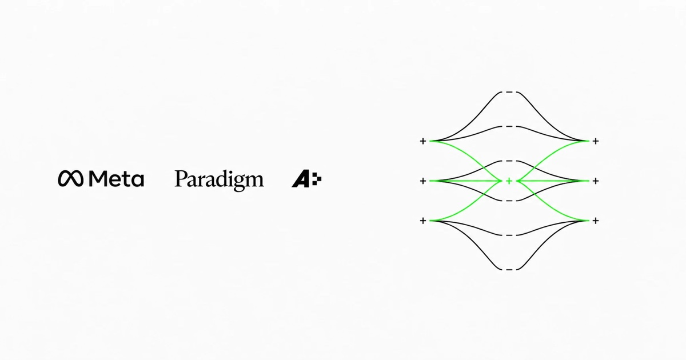

[](https://openkernelchallenge.dev/)

# Open Kernel Challenge

Participação da equipe **betitanx** na vertente de kernels do **Muse Spark Open Kernel Challenge**, com foco em **`muse_bf16_proj`**: projeções densas BF16 e roteador FP32 do Muse Spark Open, avaliados contra o SGLang em uma NVIDIA H200.

Este repositório reúne **três soluções**: a versão publicada no leaderboard e as duas candidatas distintas com maiores resultados globais de check entre os arquivos restantes do nosso histórico. O check da própria versão publicada não conta como outra solução.

## Resultado da participação

| Medida | Resultado |
|---|---|
| Equipe | betitanx |
| Problema | `muse_bf16_proj` |
| Melhor submissão pontuada válida | **1,574877619×** sobre o SGLang |
| Intervalo oficial de 95% | **[1,551254455; 1,598500783]** |
| Posição registrada no encerramento, em 05/11/2026 às 08h UTC | **192ª, provisória** |
| Posição na consulta de 05/11/2026, às 14h13 UTC | **194ª, provisória** |
| Encerramento da etapa de kernels | 05/11/2026, 08h UTC — 05h de Brasília |
| Avaliações oficiais acumuladas | **126: 121 checks e 5 submissões pontuadas** |
| Arquivos distintos avaliados | 120 hashes de código |

A posição final homologada depende da revisão dos organizadores. O objetivo de chegar ao top 5 não foi atingido. O [leaderboard oficial](https://openkernelchallenge.dev/problems/muse_bf16_proj) pode mudar após o encerramento por conclusão de jobs já aceitos e revisão das submissões.

A publicação melhorou **3,96%** sobre nossa versão válida anterior, de 1,514866388×, com intervalos separados. Uma submissão antiga de 1,540954514× foi desclassificada por conter fonte codificada/compactada decodificada em tempo de execução; ela ficou fora deste repositório e do critério de melhor resultado válido.

## As três soluções

| Arquivo | Resultado global | IC de 95% | Situação |
|---|---:|---|---|
| [Solução publicada](solucoes/solucao_publicada.py) | **1,574877619×** | [1,551254455; 1,598500783] | Submissão pontuada; está no leaderboard. |
| [Candidata 1 — cuBLASLt O256](solucoes/candidata_01_lt_o256.py) | **1,595119240×** | [1,571192451; 1,619046028] | Check aprovado; o plano parental foi mantido. |
| [Candidata 2 — router QS8](solucoes/candidata_02_router_qs8.py) | **1,582186524×** | [1,558453726; 1,605919322] | Check aprovado; o kernel novo executou. |

Os três arquivos passaram pelos **9 testes de correção, 30 formatos de benchmark e 30 perfis**, sem flags de rejeição nessas avaliações. Os códigos são cópias exatas dos artefatos avaliados; hashes e IDs de job estão no [manifesto](resultados/manifesto.json).

### Solução publicada

Reprodução integral e legível da solução pública de [keell0renz](https://github.com/keell0renz/muse-open-kernel-challenge/tree/890809cee421500b00126d084e81b338ef9181ab), com licenças e avisos completos preservados. O mesmo arquivo obteve **1,586848975× em check** antes da submissão pontuada de 1,574877619×.

A composição usa kernels especializados para 26 rotas e mantém quatro projeções BF16 de M256 em cuBLASLt. Inclui compactação sem perda dos pesos BF16, kernels GEMV/GEMM, TMA/WGMMA e a decomposição permitida dos pesos FP32 do roteador em BF16 hi + lo, com acumulação FP32.

### Candidata 1 — busca limitada de plano cuBLASLt

A H238/v253 consulta alternativas somente para a projeção `o` com M256, preservando BF16, acumulação FP32, workspace zero e o contrato de alinhamento. As alternativas elegíveis são verificadas numericamente e comparadas com o plano parental em grafos CUDA com entradas novas e L2 frio.

As três alternativas medidas perderam para o plano parental, que continuou selecionado. Portanto, **1,595119240× é o resultado daquela execução com o plano anterior mantido**, sem demonstração de aceleração causada pela busca. A candidata foi arquivada e não substituiu a publicação.

### Candidata 2 — oito estágios no roteador

A H245/v258 amplia o anel de carregamento de seis para oito estágios somente no roteador M128/S16, com 128 CTAs. Preserva a ordem de cálculo hi/lo, a redução FP32 e os demais caminhos. A memória compartilhada dinâmica passa de 148.648 para 197.832 bytes por bloco.

O perfil confirmou a execução de `rk_qs8_kernel`. A melhora não foi consistente quando comparada tanto à submissão pontuada quanto ao check da mesma versão parental; os intervalos globais também se sobrepõem. Por isso, a candidata permaneceu como resultado experimental.

## O que a vertente avaliava

Cada chamada calcula uma projeção `x @ W.T`. As camadas são `qkv_gate`, `o`, `pooler`, `unpooler` e `router`, nos lotes M = 1, 8, 16, 32, 128 e 256. As projeções e ativações usam BF16; os pesos e a saída do roteador são FP32, com a decomposição hi + lo expressamente permitida pelo problema.

O protocolo oficial usa grafos CUDA, entradas novas, repetições pareadas com ordem alternada e L2 frio. A pontuação agrega as camadas de cada carga e toma a média geométrica entre as seis cargas. Os resultados aqui medem **projeções isoladas em uma H200**; não medem a aceleração do modelo completo servido em oito GPUs.

Especificação e regras: [problema](https://openkernelchallenge.dev/problems/muse_bf16_proj), [guia oficial](https://openkernelchallenge.dev/llms.txt) e [regras](https://openkernelchallenge.dev/rules).

## Estratégia de autoresearch

A pesquisa foi assistida por agentes, com controle explícito dos experimentos e das publicações:

1. **Contexto específico.** Mantivemos skills locais sobre a H200/SM90 e o Muse Spark Open, junto ao contrato do problema e às regras de precisão. Recursos de outras arquiteturas não eram presumidos como disponíveis.
2. **Hipótese antes de variante.** Cada proposta registrava o gargalo esperado, a mudança concreta, os riscos e o resultado que justificaria continuar. Organizamos até duas hipóteses novas por vez.
3. **Três revisores fixos.** Agentes GPT-6.1 Sol com raciocínio extra alto auxiliavam em pesquisa e revisão, somente em leitura. O agente principal centralizava alterações, seleção de candidatas e envios sequenciais.
4. **Validação local antes da cota remota.** Usamos verificações de layouts, cobertura, precisão em CPU, modelos de sincronização e compilação nativa. Registradores, spills e SASS ajudavam a diagnosticar; não eram tratados como prova de desempenho H200.
5. **Checks oficiais guiando a próxima decisão.** Antes de cada envio, reavaliávamos as candidatas disponíveis. A cota da API era o limite real na reta final; não havia espera obrigatória entre avaliações. Jobs pendentes eram acompanhados antes de iniciar outro.
6. **Publicação seletiva.** Uma combinação precisava de validação integral e ganho demonstrado além da incerteza sobre a melhor publicação. Submissões pontuadas não substituíam checks; resultados apenas nominalmente maiores não eram promovidos.
7. **Memória experimental.** O laboratório registrava hipótese, SHA-256, job, correção, intervalo, regressões e decisão, permitindo descartar variantes já negativas e preservar a melhor versão publicada.

Na reta final foram **15 checks e uma submissão pontuada**. Ao encerrar, o histórico continha 186 entradas nativas emitidas localmente, incluindo controles; essa contagem é distinta das 126 avaliações oficiais. A pesquisa preservou carga, precisão, entradas novas, grafos CUDA e L2 frio. Não alterou o avaliador, não usou cache de ativações ou saídas e não relaxou tolerâncias para aprovar variantes. O uso de bibliotecas está explicitado nas descrições das soluções.

## Arquivos e reprodução

```text
solucoes/
  solucao_publicada.py
  candidata_01_lt_o256.py
  candidata_02_router_qs8.py
resultados/
  manifesto.json
  publicada.json
  candidata_lt_o256.json
  candidata_router_qs8.json
assets/
  banner-oficial.jpg
```

Cada solução é um arquivo independente no formato OKC, com a primeira linha `# okc: problem=muse_bf16_proj` e as funções `prepare(weights)` e `kernel_fn(data, state)`. Os JSONs incluem resultados globais, intervalos, estados dos testes, latências por formato, razões pareadas e perfis resumidos.

As soluções dependem da H200 e da stack CUDA/PyTorch/Triton/FlashInfer disponibilizada no ambiente oficial do desafio. A imagem de referência usada pela competição era `lmsysorg/sglang:dev-muse-spark-open`; o rótulo da imagem, sozinho, não fixa todas as versões para uma reprodução futura. Não foram executados novos testes de desempenho para preparar este repositório após o encerramento da etapa.

Para conferir a integridade dos arquivos no PowerShell:

```powershell
Get-FileHash .\solucoes\*.py -Algorithm SHA256
```

Compare o resultado com `resultados/manifesto.json`. Uma nova medição depende de um ambiente compatível e da disponibilidade do serviço; este repositório preserva as medições feitas durante a competição.

## Créditos e licenças

A velocidade da solução publicada vem em grande parte de implementações públicas da comunidade. Este repositório não reivindica autoria exclusiva desses kernels.

- [keell0renz/muse-open-kernel-challenge](https://github.com/keell0renz/muse-open-kernel-challenge): composição utilizada pela publicação, fixada no commit `890809cee421500b00126d084e81b338ef9181ab`.
- [vjeux/okc-2026](https://github.com/vjeux/okc-2026), [alygg77/okc-muse-spark-kernels](https://github.com/alygg77/okc-muse-spark-kernels) e [chenwainuo/okc](https://github.com/chenwainuo/okc): bases e componentes especializados, conforme os avisos originais.
- [NathenFernandes/muse-bf16-proj](https://github.com/NathenFernandes/muse-bf16-proj): componentes sob licença MIT, com o texto integral preservado nos arquivos.
- Matsvei (`matvey`, kernarc) e os demais autores identificados em [NOTICE](NOTICE) e nos cabeçalhos originais.

Código distribuído sob [Apache-2.0](LICENSE), respeitando as licenças e atribuições dos componentes incorporados. Os textos legais e os cabeçalhos originais foram mantidos; a documentação da participação está em português-BR.

O [banner oficial](https://openkernelchallenge.dev/opengraph-kernels.jpg?v=7) foi obtido no site da competição. Marcas e elementos visuais pertencem aos respectivos titulares; a licença do código não transfere direitos sobre essas marcas.
